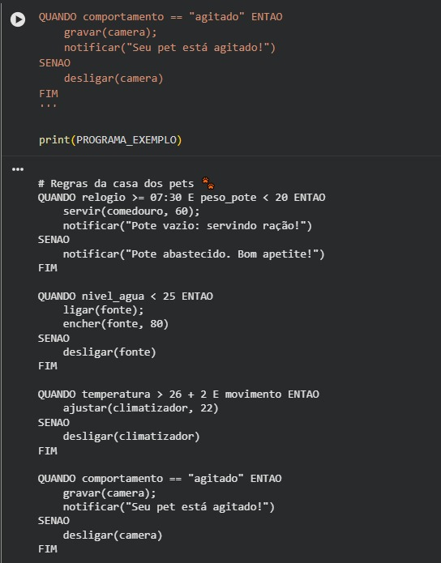
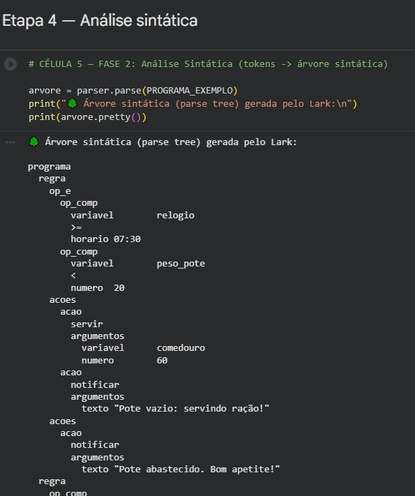
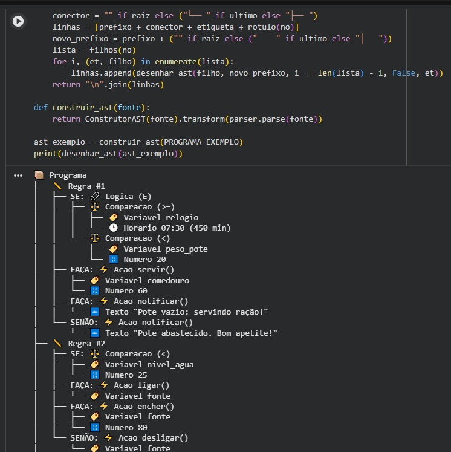
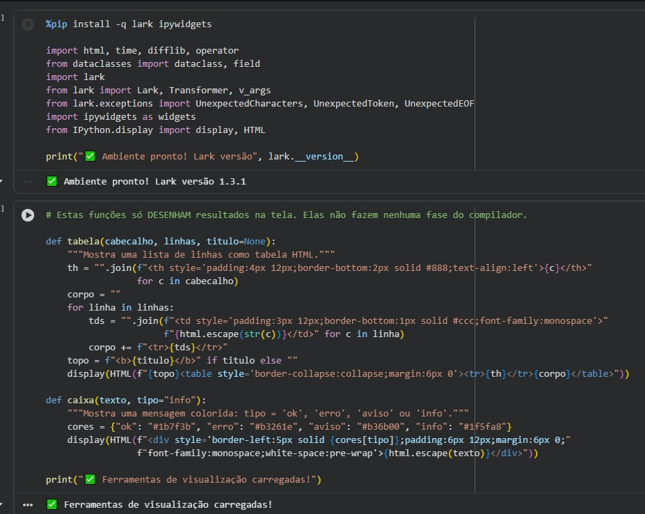
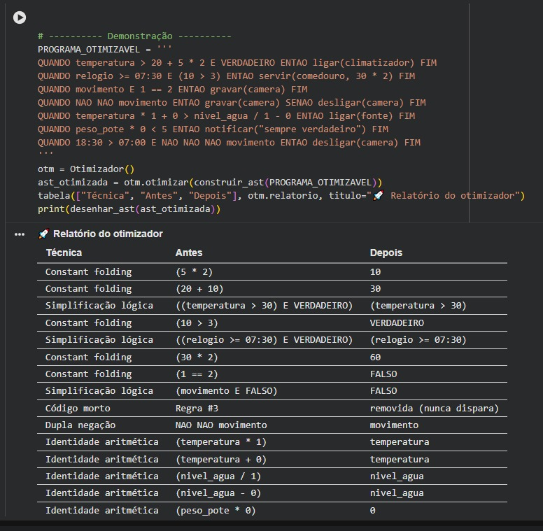
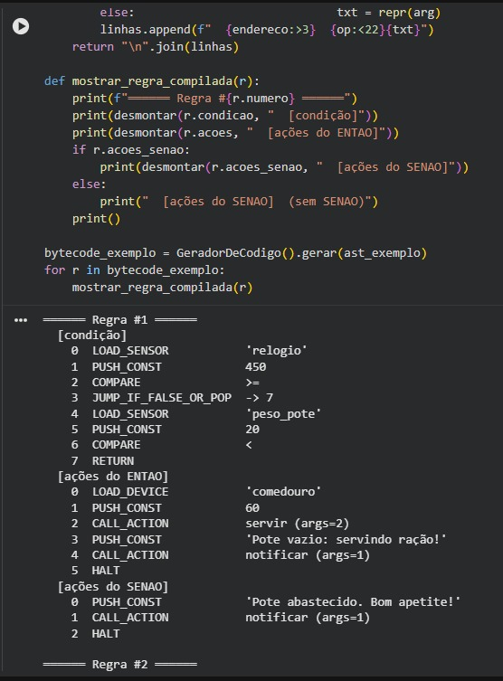
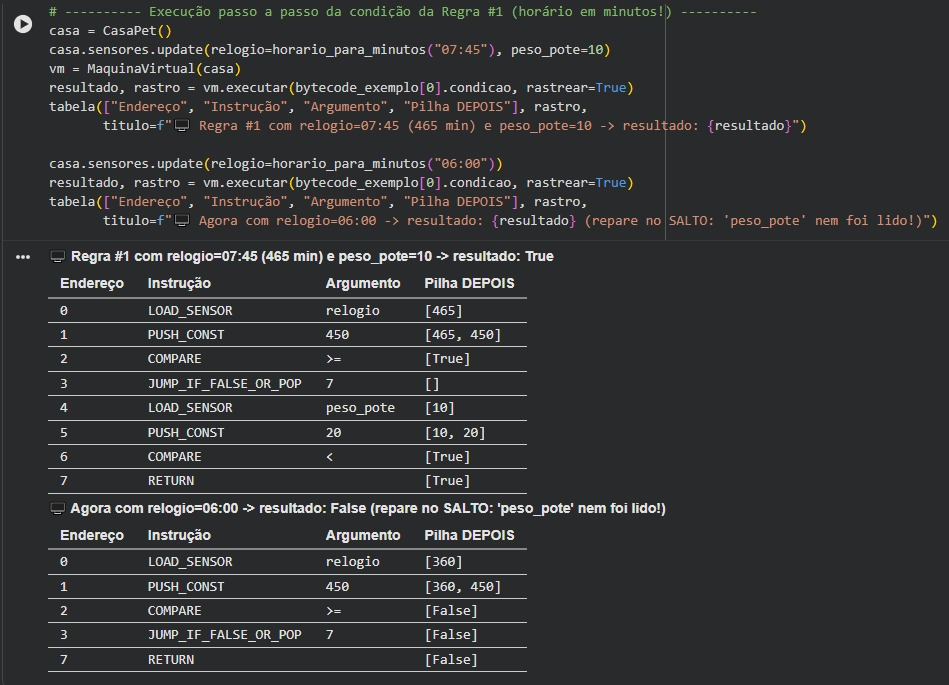
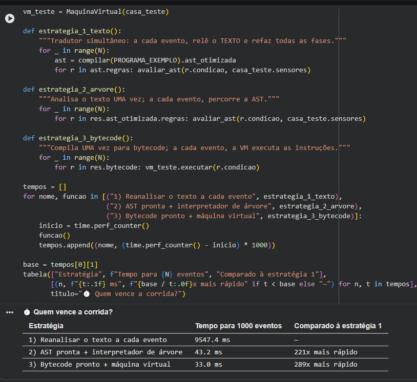
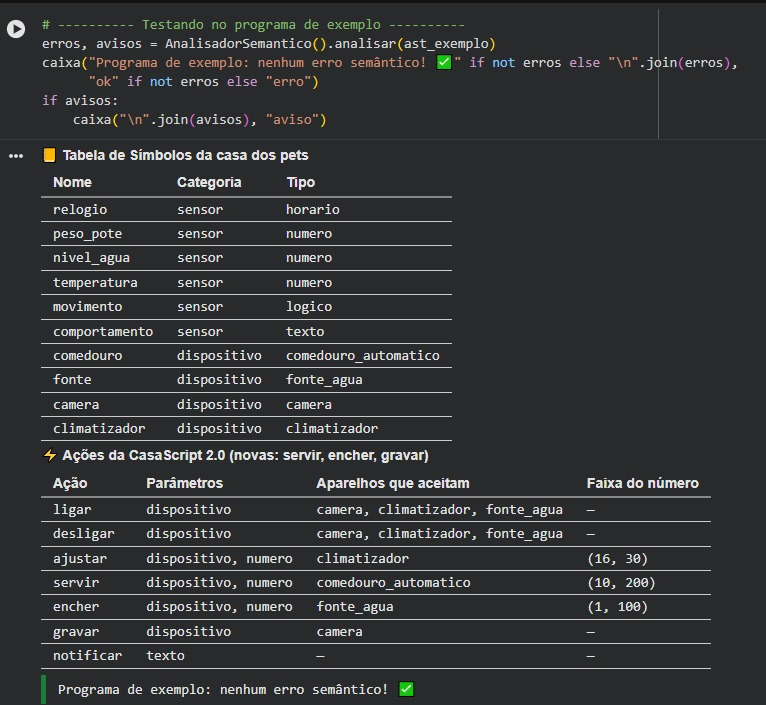

**Integrantes:**

- Bruno dos Reis Ferreira Santos — RA: 2564952
- Vinicius de Freitas Ferreira — RA: 2373516
- Matheus Francisco — RA: 2693112
- Matheus de Oliveira — RA: 2693112

---

# 🐾 CasaScript 2.0 — Casa para Pets

Projeto de entrega da **Aula CP 06 (Prática 2) — Construindo um Compilador Completo** · Ciência da Computação · Compiladores


---

## Demonstração visual

### Programa de exemplo


### Análise sintática


### Árvore AST


### Ambiente e ferramentas de visualização


### Otimização


### Bytecode


### Execução na máquina virtual


### Comparação de desempenho


### Análise semântica


---

## 1. Cenário escolhido: Casa para Pets

**Problema de mercado.** Quem tem cachorro ou gato sabe que a rotina do pet não espera o tutor chegar em casa: a ração precisa ser servida no horário, a água não pode acabar, o ambiente não pode ficar quente demais e, se o animal ficar agitado, o tutor quer saber na hora. O mercado de *pet tech* (comedouros automáticos, fontes de água inteligentes, câmeras e climatizadores conectados) cresce justamente em cima disso, e cada fabricante precisa de uma forma segura de deixar o tutor escrever essas regras. Uma regra errada tem consequência real: um sensor inexistente ou um valor impossível faz a ração nunca ser servida, e o tutor só descobre quando o animal já passou o dia sem comer. A CasaScript 2.0 resolve isso com uma DSL pequena, e o compilador funciona como "portão de segurança": nenhuma regra com erro chega aos aparelhos.

---

## 2. Tabela de símbolos

### Sensores (6)

| Sensor | Tipo | Valores possíveis |
|---|---|---|
| `relogio` | **horario** | `00:00` a `23:59` (guardado em minutos) |
| `peso_pote` | número | 0 a 500 (gramas de ração no pote) |
| `nivel_agua` | número | 0 a 100 (% de água na fonte) |
| `temperatura` | número | -10 a 50 (°C) |
| `movimento` | lógico | `VERDADEIRO` ou `FALSO` |
| `comportamento` | texto | `"calmo"`, `"agitado"`, `"dormindo"` ou `"comendo"` |

### Dispositivos (4 dispositivos, 4 tipos)

| Dispositivo | Tipo |
|---|---|
| `comedouro` | comedouro_automatico |
| `fonte` | fonte_agua |
| `camera` | camera |
| `climatizador` | climatizador |

### Ações

| Ação | Parâmetros | Aceita | Faixa do número |
|---|---|---|---|
| `ligar`, `desligar` | dispositivo | fonte_agua, camera, climatizador | — |
| `ajustar` | dispositivo, número | climatizador | 16 a 30 |
| `servir` 🆕 | dispositivo, número (gramas) | comedouro_automatico | 10 a 200 |
| `encher` 🆕 | dispositivo, número (nível %) | fonte_agua | 1 a 100 |
| `gravar` 🆕 | dispositivo | camera | — |
| `notificar` | texto | — | — |

---

## 3. O que foi alterado em cada requisito

### RF1 — Léxico: literal de horário · *fase léxica (e tipos, otimização e geração de código)*
- **Célula 3 (gramática):** novo terminal `HORARIO.2 : /(?:[01]\d|2[0-3]):[0-5]\d(?!\d)/` e a alternativa `HORARIO -> horario` em `?atomo`. A **prioridade 2** faz o `HORARIO` vencer o `NUMERO` (já que `18:30` também começa como `18`). O `(?!\d)` impede `18:300`.
- `25:00` e `18:75` não casam com o `HORARIO`; o `NUMERO` consome `25` e o `:` sobra, gerando **erro léxico**. A mensagem de erro (Célula 12) ganhou uma dica específica para esse caso.
- **Célula 6 (AST):** novo nó `Horario(valor)` com o valor **em minutos** (`18:30 → 1110`), mais `horario_para_minutos()` e `formatar_horario()`.
- **Célula 7 (semântica):** `tipo()` devolve `"horario"`; horários só se comparam com horários.
- **Célula 9 (otimizador):** `e_constante()` e `mostrar()` reconhecem `Horario` (ex.: `18:30 > 07:00` vira `VERDADEIRO`).
- **Célula 10 (bytecode):** o horário sai como `PUSH_CONST 1110`.

### RF2 — Sintático: bloco `SENAO` · *fase sintática (AST, bytecode e runtime)*
- **Célula 3:** `regra : "QUANDO" expr "ENTAO" acoes ["SENAO" acoes] "FIM"`. O `[ ]` gera `None` quando o bloco não existe.
- **Célula 6:** `Regra` ganhou `acoes_senao`; `filhos()` desenha os nós `SENÃO:` na AST.
- `SENAO FIM` (bloco vazio) dá **erro sintático**, porque depois do `SENAO` a gramática exige uma ação.
- **Células 10 e 13:** o `SENAO` vira o 3º bloco de bytecode e é executado na borda de descida.

### RF3 — Semântico · *fase semântica*
- **Célula 7:** tabela de símbolos do cenário (seção 2), faixas para sensores numéricos (`FAIXA_SENSOR`) e para ações com número (`FAIXA_ACAO`).
- Ações do `SENAO` passam por `verificar_acao()`, as **mesmas** verificações do `ENTAO`.
- **Aviso novo 1:** a mesma ação com os mesmos argumentos repetida dentro da regra (comparada com `mostrar_acao()`).
- **Aviso novo 2:** duas regras diferentes com exatamente a mesma condição (comparada com `mostrar()`).

### RF4 — Otimização: duas técnicas novas · *fase de otimização*
- **Célula 9:** `dupla_negacao()` (`NAO NAO x → x`) e `identidade_aritmetica()` (`x+0`, `x-0`, `x*1`, `x/1 → x` e `x*0 → 0`).
- `otimizar_expr()` chama primeiro a otimização existente (`otimizar_base()`) e aplica as novas em cima do resultado. As duas aparecem no relatório com técnica, antes e depois.
- O otimizador preserva o `acoes_senao` ao reconstruir a regra.

### RF5 — Geração de código e runtime · *geração de código / execução*
- **Célula 10:** `RegraCompilada` tem três blocos: `condicao`, `acoes` (ENTAO) e `acoes_senao`. `gerar_acoes()` serve para os dois blocos.
- **Célula 11:** classe `CasaPet` (comedouro, fonte, câmera e climatizador) com a execução de `servir`, `encher` e `gravar`.
- **Célula 13:** `CentralDeAutomacao` dispara o `ENTAO` na **borda de subida** (FALSO → VERDADEIRO) e o `SENAO` na **borda de descida** (VERDADEIRO → FALSO).

### RF6 — Testes e simulação · *integração*
- **Célula 16:** bateria com **18 casos**: 6 corretos, 3 léxicos (incluindo `25:00` e `18:75`), 4 sintáticos (incluindo `SENAO` vazio), 5 semânticos (incluindo erro dentro do `SENAO`).
- **Célula 13:** simulação de um dia com **13 eventos** exibida em tabela, com `ENTAO` e `SENAO` disparando.
- **Célula 17 (extra):** verifica um a um os itens da checklist do enunciado.

---

## 4. Exemplo de programa e bytecode gerado

```
QUANDO relogio >= 07:30 E peso_pote < 20 ENTAO
    servir(comedouro, 60);
    notificar("Pote vazio: servindo ração!")
SENAO
    notificar("Pote abastecido. Bom apetite!")
FIM

QUANDO temperatura > 26 + 2 E movimento ENTAO
    ajustar(climatizador, 22)
SENAO
    desligar(climatizador)
FIM
```

Bytecode (com otimização ligada; repare no `26 + 2` já resolvido para `28` e no horário `07:30` virando `450`):

```
══════ Regra #1 ══════
  [condição]
    0  LOAD_SENSOR           'relogio'
    1  PUSH_CONST            450
    2  COMPARE               >=
    3  JUMP_IF_FALSE_OR_POP  -> 7
    4  LOAD_SENSOR           'peso_pote'
    5  PUSH_CONST            20
    6  COMPARE               <
    7  RETURN
  [ações do ENTAO]
    0  LOAD_DEVICE           'comedouro'
    1  PUSH_CONST            60
    2  CALL_ACTION           servir (args=2)
    3  PUSH_CONST            'Pote vazio: servindo ração!'
    4  CALL_ACTION           notificar (args=1)
    5  HALT
  [ações do SENAO]
    0  PUSH_CONST            'Pote abastecido. Bom apetite!'
    1  CALL_ACTION           notificar (args=1)
    2  HALT

══════ Regra #2 ══════
  [condição]
    0  LOAD_SENSOR           'temperatura'
    1  PUSH_CONST            28
    2  COMPARE               >
    3  JUMP_IF_FALSE_OR_POP  -> 5
    4  LOAD_SENSOR           'movimento'
    5  RETURN
  [ações do ENTAO]
    0  LOAD_DEVICE           'climatizador'
    1  PUSH_CONST            22
    2  CALL_ACTION           ajustar (args=2)
    3  HALT
  [ações do SENAO]
    0  LOAD_DEVICE           'climatizador'
    1  CALL_ACTION           desligar (args=1)
    2  HALT
```

---

## 5. Bônus implementados

- **Divisão por zero em expressões constantes:** `temperatura / (5 - 5)` também é erro semântico (`valor_constante()` resolve a conta antes), e `x * 0` conta como zero nessa verificação. O otimizador nunca dobra uma divisão por zero.
- **Identidades comutativas:** além das pedidas, `0 + x` e `1 * x` → `x`, e `0 * x` → `0`.
- **Otimização dos argumentos das ações:** `servir(comedouro, 30 * 2)` vira `servir(comedouro, 60)`.
- **Faixa de ações com expressões:** `servir(comedouro, 100 + 200)` também é checado contra a faixa (10 a 200).
- **Mensagem de erro dedicada** para horário inválido (`25:00`, `18:75`), explicando que horários vão de `00:00` a `23:59`.
- **Aviso extra:** `ligar` e `desligar` do mesmo aparelho no mesmo bloco.
- **Studio atualizado:** controles dos sensores do cenário (com o relógio mostrado em `HH:MM`), bytecode com os três blocos e botão *Simular um dia*.
- **Testes extras (Célula 17):** uma verificação para cada item da checklist de entrega.
